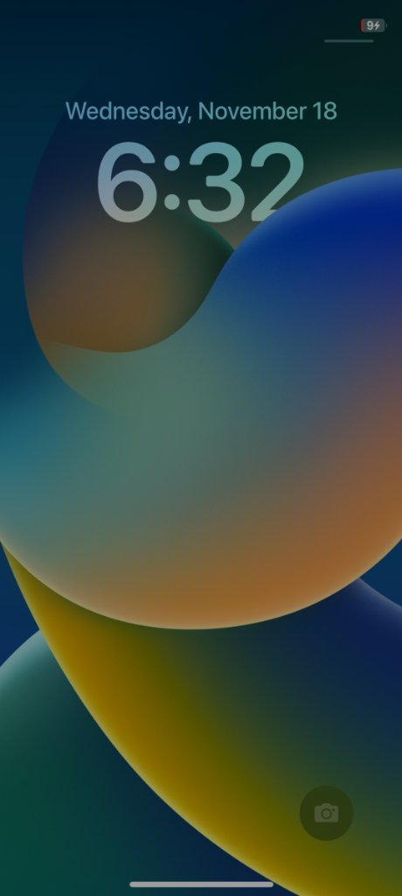
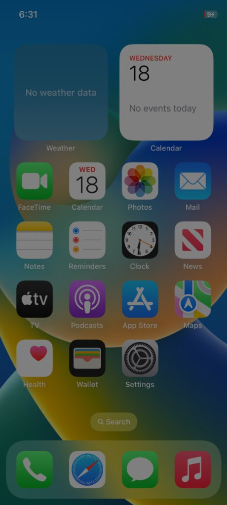
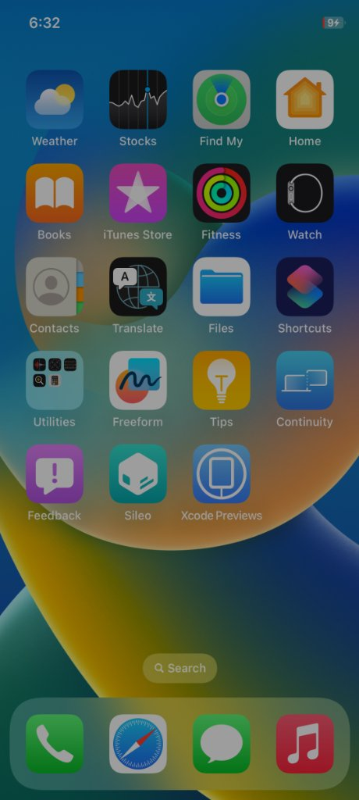
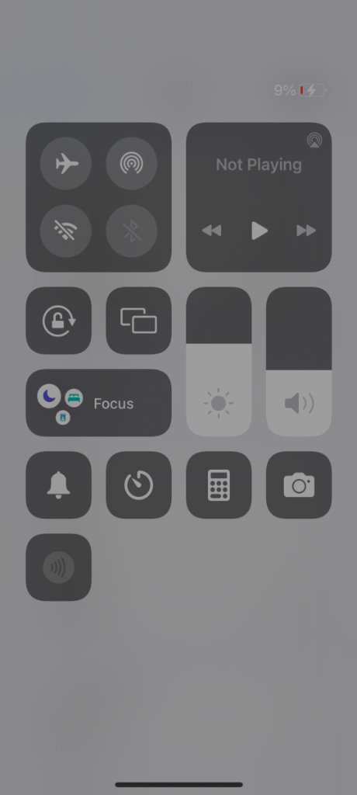
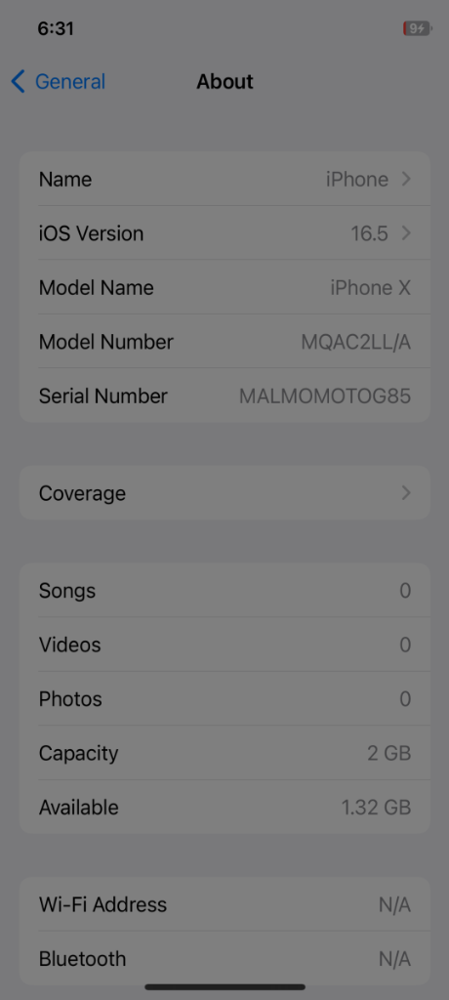

# HakiOS for Motorola Moto G84 5G (`bangkk` / SM6375)

> **Port of Apple's open-source Darwin XNU kernel (xnu-8796.121.2) and iOS 16.5 SpringBoard GUI to the Motorola Moto G84 5G**

---

## 📊 Overall Porting Progress: **~0% Complete**

The iOS 16.5 SpringBoard user interface boots directly into live RAM without modifying your device's Android partitions. A simple reboot returns the phone completely back to stock Android.

---

## 📸 Screenshots

| Lock Screen | Home Screen (Widgets) | Home Screen (Apps) |
|:---:|:---:|:---:|
|  |  |  |

| Control Center | Settings — About |
|:---:|:---:|
|  |  |

---

## ⚙️ Hardware Support & Status

| Component / Subsystem | Status | Progress | Notes |
|---|:---:|:---:|---|
| **CPU / Multicore** | ✅ Working | 100% | 8 Kryo cores (2x Gold + 6x Silver), `bootcpu=7 cpus=7`, full SMP |
| **Battery & Charging** | ✅ Working | 100% | Qualcomm PM7250B / SMB5 hardware fuel gauge via UEFI `ChargerExDxe` & `QcomChargerDxeLA`: real-time battery percentage, voltage (mV), charge current & charging lightning bolt in status bar/lock screen (`battery=1`) |
| **Storage / APFS Ramdisk** | ✅ Working | 100% | Live APFS ramdisk (`root.apfs`, `system.apfs`), lz4 compressed |
| **Display (Framebuffer)** | ✅ Working | 100% | 1080x2400 OLED, smooth 120 Hz refresh rate (`fb_hz=120`, `ca_vbl=1`), brightness control in Control Center |
| **GPU (Adreno 619)** | ✅ Working | 90% | Hardware-accelerated UI via `hakios-gl` / Mesa Freedreno, Metal translation |
| **Touchscreen (Touch)** | ✅ Working | 95% | FocalTech FT3683G (I2C SE1), multi-touch & gesture navigation |
| **Physical Buttons** | ✅ Working | 100% | Power and Volume (+/-) via PMIC PON driver |
| **Haptics / Vibration** | ✅ Working | 100% | Awinic AW86927: EGPIO reset bit logic, boost 0xd0 (vmax 8500 mV), max gain 0xff, RAM waveforms + CONT buzz fully working |
| **Audio / Speakers** | 🟡 In Progress | 82% | FourSemi FS1815: GPIO4/5 bit-bang I2C, ADSP TZ auth, Blair stream `0xa1`, fastrpc SMMU early page |
| **Wi-Fi** | ✅ Working | 100% | WCN3990 (SNOC) + ath10k shim: full stack operational, WLFW handshake, scanning, association & network working |
| **Bluetooth** | 🟡 In Progress | 45% | WCN3990 UART / QCA coex (GPIO 69), driver under active development |
| **Cellular Modem (LTE/5G) / MPSS** | 🟡 In Progress | 45% | MPSS boots (`smem_lock=0x343000`), RPM GLINK `IPA_CLK` (100 MHz) + `snoc/bimc/cnoc` votes, IPA v4.5 (`0x05840000`) & 512KB SMMU (`0x4a0..0x4a3`); debugging hang when `ipa_fw=1` + MPSS run together |
| **Cameras** | 🔴 Planned | 10% | Requires porting Qualcomm Spectra ISP & Sony LYT-600 sensors |

---

## 🎨 Userland, SpringBoard & PosterBoard

| Service / Component | Status | Notes |
|---|:---:|---|
| **SpringBoard** | ✅ Working | Complete iOS 16.5 shell, app launch & switch, widgets, folders, dock |
| **PosterBoard / Wallpapers** | 🟡 Partial | Lock screen wallpaper renders properly; poster switcher hook returns `NO` (prevents black screen compositing glitch); ExtensionKit posters load in background; home screen blur freeze via `wallpaper_freeze=1` |
| **Control Center** | ✅ Working | Brightness slider, volume, connectivity buttons, flashlight, focus modes |
| **Sileo / Package Manager** | ✅ Working | Rootless package management (`/var/jb`), repo refreshing, tweak support |

---

## 🚀 Boot Command & Kernel Arguments

The system is booted via the custom **HakiOS XNULoader v3** (`loader.efi`) chained from **Mu-Silicium UEFI**:

```bash
XL_SECS=36000 XL_FOLLOW=10 XL_CMDLINE="touchscreen=1 buttons=1 bootcpu=7 cpus=7 gpu=1 battery=1 fb_hz=120 fb_threads=6 ca_vbl=1" ./xl run
```

### Key Kernel Arguments (`XL_CMDLINE`):
- `battery=1`: Reads hardware battery percentage, voltage, and charging status from Qualcomm UEFI charger stack.
- `gpu=1`: Enables the Adreno 619 GPU driver and hardware rendering pipeline.
- `fb_hz=120`: Forces 120 Hz display refresh rate for fluid scrolling and animations.
- `touchscreen=1`: Enables the FocalTech FT3683G touch controller (I2C SE1, GPIO 0/1).
- `buttons=1`: Enables power and volume key monitoring.
- `adsp=1 sound=4`: Boots the Hexagon Audio DSP and routes sound through FourSemi FS1815 stereo amplifiers.
- `wifi=1`: Starts the WCN3990 Wi-Fi radio stack via ICNSS (`wifi_loud=1` enables verbose logs).
- `modem=1`: Starts the MPSS modem subsystem (`modem_loud=1`, `modem_image_nocheck=1`, `modem_ipa_nohw=1`, `modem_no_start=1` for diagnostics).

---

## 🛠️ Port Architectural Highlights (`malmo` / SM6375)

1. **Snapdragon 695 / 6s Gen 3 (SM6375, Blair Platform):**
   - Unlike Snapdragon 778G (SC7280/redwood) which uses RPMh RSC, SM6375 relies on **RPM-SMD** and SPMI power distribution.
   - The ADSP driver (`drivers/audio/hakios.adsp.c`) and Wi-Fi driver (`drivers/wifi/hakios.wifi.c`) were refactored to perform direct SPMI register reads for LPASS rails (`ldoa1`, `ldoa17`).
2. **FourSemi FS1815 Smart Audio Amplifiers:**
   - Dedicated driver in `drivers/audio/hakios.speaker.c` with register sequences from `drivers/audio/hakios.fs1815.h` (extracted from `/vendor/firmware/fs1815.fsm`).
   - Dual-channel I2C addressing (`0x34` right / `0x35` left) with hardware shutdown pins on GPIO 48 and GPIO 59.
3. **WCN3990 Connectivity Radio & ath10k Shim:**
   - Hardware power-on via `cnss_wlan_en` (GPIO 84) output drive, and MSA memory window preparation for firmware load (`wlanmdsp.mbn`).
   - **Blair-specific boot path**: `whole_thread()` now selects step sequence `{1,2,6,7,8,12,13,14,15}` for Blair/WCN3990, skipping WPSS image write (step 9), SMP2P (step 10), and TrustZone `SCM_PAS_AUTH_AND_RESET` with `PAS_WPSS` (step 11) — the DSP is started directly via ICNSS registers in step 8.
   - **ath10k integration**: Added `wifi/lx/src/lx_bus_ath10k.c` and `tools/mk-ath10k.sh` for linking ath10k directly into the kernel image via `xnu-build.sh`.
   - **WLFW exchange updates**: Handles QMI MSA info (`0x2d`), MSA ready (`0x2e`), calibration reports (`0x26`), and automatic fallback to board ID 0 for raw BDF bin (`bdwlan_malmo_ipa.bin`).
4. **AW86927 Haptics Tuning:**
   - Full Android `haptic_hv_hw_reset()` sequence: GPIO 89 LOW 5 ms → HIGH → 15 ms settle, then I2C on SE8 (GPIO 19/20).
   - Dynamic `reset_egpio_bit()` logic to preserve `EGPIO_ENABLE` (bit 12) whenever `EGPIO_PRESENT` (bit 11) is active on the TLMM GPIO line.
   - PMIC PM7250B vibrator LDO (channel 390 / 0x5300) enabled at 3.0V before reset release.
   - Configured boost on `PLAYCFG1` (`0xd0`), max output gain (`0xff`), and verified both RAM waveforms and continuous 250 ms vibration bursts.
5. **SpringBoard & PosterBoard Wallpaper Compositing:**
   - On iOS 16, PosterBoard runs in an independent userland process hosted inside SpringBoard. Due to OpenGL ES / freedreno offscreen compositing constraints with `CALayerHost`, long-press poster switching is intercepted (`_allowsCapabilityPosterSwitcherWithExplanation:` returns `NO`) to prevent black screen lockups.
   - Poster collections and templates via ExtensionKit start in background speculative QoS (~400s after initial boot settling).
   - Use `wallpaper_freeze=1` in boot-args to snapshot the active framebuffer as a static cached wallpaper for the home screen.
6. **MPSS & IPA v4.5 (`drivers/modem/hakios.mpss.c`):**
   - **RPM-SMD GLINK (`rpm_requests`)**: `blair_rpm_enable_ipa_clk()` reuses UEFI's open `rpm_requests` GLINK channel over IPCC, requests `IPA_CLK` (`100 MHz`) and votes for `snoc` (`200 MHz`), `bimc` (`400 MHz`), and `cnoc` (`100 MHz`) across `set=0` (active) and `set=1` (sleep).
   - **IPA v4.5 hardware & memory**: Probes `0x05840000` (`ipa_regs_find()`) and initializes 12,288 bytes (`0x600`) of IPA shared memory (`0x54`).
   - **SMMU Context 4**: `ipa_space_on()` supports Blair's 512 KB SMMU (`idr1 = 0x50000030`) and maps streams `0x4a0..0x4a3`.
   - **Known issue**: `ipa_fws` loads cleanly with `modem_no_start=1`, and MPSS reaches `slave-kernel` (+621 ms) with `modem_ipa_fw=0`, but running `ipa_fw=1` + MPSS together currently hangs ~0.6–0.8 s after modem start.

---

## 📄 License & Credits

- XNU Kernel: [Apple Public Source License 2.0 (APSL)](LICENSE.APSL)
- HakiOS drivers and userland toolchain: [MIT License](LICENSE)
- Upstream project: [oosexgang/hakios-xnu-kernel](https://github.com/oosexgang/hakios-xnu-kernel)
