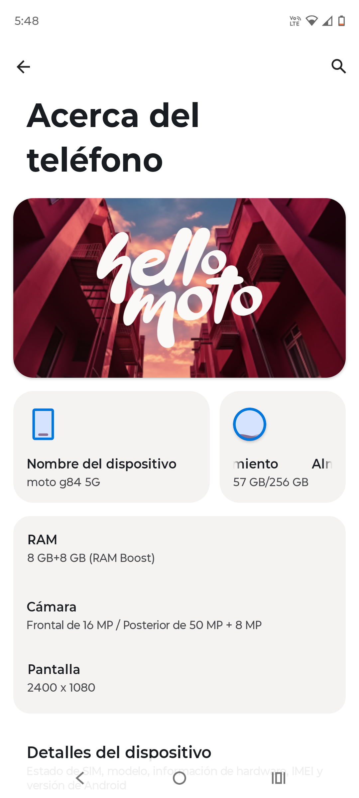
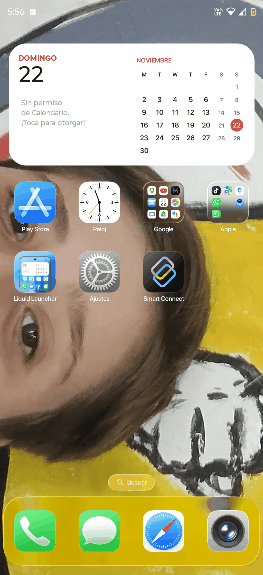

# HakiOS for Motorola Moto G84 5G (`bangkk` / SM6375)

> **Port of Apple's open-source Darwin XNU kernel (xnu-8796.121.2) and iOS 16.5 SpringBoard GUI to the Motorola Moto G84 5G**

---

The iOS 16.5 SpringBoard user interface boots directly into live RAM without modifying your device's Android partitions. A simple reboot returns the phone completely back to stock Android.

---

## 📸 Screenshots (In android)

## (In iOS)

---

## 📄 License & Credits
- XNU Kernel: [Apple Public Source License 2.0 (APSL)](LICENSE.APSL)
- HakiOS drivers and userland toolchain: [MIT License](LICENSE)
- Upstream project: [oosexgang/hakios-xnu-kernel](https://github.com/oosexgang/hakios-xnu-kernel)
